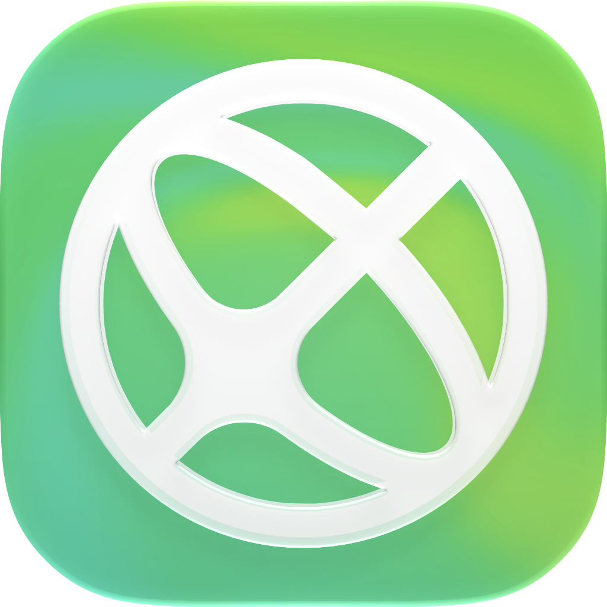

<p align="center"></p>

<h1 align="center">Garner</h1>

<p align="center">Private, local-first personal finance for macOS.</p>

Garner keeps your crypto, your bank accounts and where your money goes in one SQLite file on your Mac. No account, no cloud, no telemetry. Your own AI app can read and organize it through Garner's MCP server.

> Garner is in development and has no download yet. The first signed release will come from [garner.money](https://garner.money). Until then, build it from source.

## What it does

- **Crypto.** Watch-only addresses on Ethereum, Base, Arbitrum, Optimism, Polygon, BNB Chain and Avalanche, plus holdings you type in, valued every day.
- **Banks.** Statement exports from Revolut (English), Santander Portugal and ActivoBank join one ledger. Drop a file anywhere in the window.
- **Spending.** Categories and merchants, spending by month, money flow between accounts and net worth over time, in USD or EUR.
- **Transfers.** Moves between your own accounts pair up on their own, or wait for you to confirm them.
- **Search.** One palette over accounts, merchants, categories and movements, by words, periods and amounts.
- **Privacy mode.** Blurs every balance, for screen sharing.

## Your data stays on your Mac

Everything lives in `~/Library/Application Support/money.garner`. To value what you hold, Garner calls four public services, with no keys and no account:

- PublicNode, for the balances of your addresses
- CoinGecko, for the list of coins
- DefiLlama, for prices and token logos
- Frankfurter, for the ECB's exchange rates

Nothing else leaves your Mac.

## Your AI app

Connect in Settings adds Garner to Claude Desktop, Claude Code, Codex or the ChatGPT app. Your AI app can then read your portfolio and history, sync, manage institutions and accounts, and sort your bank movements into categories. Addresses are masked before they reach a model, and bank descriptions reach it only when you ask it to categorize.

## Build from source

You need macOS 27 on Apple silicon, Xcode, [Bun](https://bun.sh) and Rust 1.90 or newer.

```sh
bun install
bun dev
```

`bun dev` serves the browser build on `localhost:5173`, for development. For the desktop app, install the Tauri CLI once, then run it:

```sh
cargo install tauri-cli --version 2.12.4 --locked
bun run desktop
```

`bun run desktop:build` writes `Garner.app` to `src-tauri/target/release/bundle/macos/`. It also needs `cargo install cargo-about --version 0.9.2 --features cli --locked` for the credits. `bun check` runs the types and the linter, `bun test` the tests.

Decisions and design live in `docs/`: `foundation.md` for the product, stack and steps, then `design.md`, `ledger.md`, `ai.md` and `search.md`.

## License

[MIT](LICENSE). Vendored code and marks keep their own notices in `LICENSE-*`. Bank and exchange marks belong to their owners. The Garner name and logo are not covered by the MIT license.
